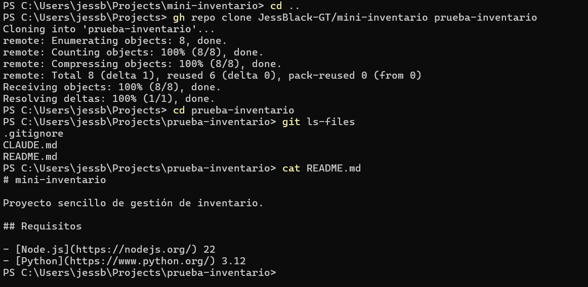

# Bitácora — Día 1: Mini Inventario

Fecha: 2026-11-11 · Repositorio: https://github.com/JessBlack-GT/mini-inventario · Asistente: Claude Code

## 1. Prompts clave

- **Crear el repositorio:** "Crea en esta carpeta un repositorio Git llamado mini-inventario. Usa gh para publicarlo como repositorio público en mi cuenta. Agrega un README corto que indique que el proyecto requiere Node.js 22 y Python 3.12, y un .gitignore para Node y Python que excluya .env, .venv y node_modules. Antes de ejecutar cada comando, explícame qué hace."
- **Crear CLAUDE.md:** "Crea el archivo de instrucciones de este proyecto (CLAUDE.md si eres Claude Code, AGENTS.md si eres Codex). Explica que Mini Inventario es una web de inventario, que el proyecto usa Node.js 22 y Python 3.12, que cada cambio va en una rama con pull request, que nunca se suben llaves ni archivos .env, y que debes pedir aprobación antes de borrar datos o desplegar. Máximo 20 líneas."
- **Integrarlo:** "sí, súbelo en una rama y abre el pull request"

## 2. Incidencias

### 2.1 Error de herramienta: PowerShell (error interno de CLR)

El primer comando (`Get-ChildItem -Force; git rev-parse --show-toplevel`) falló en la herramienta PowerShell con `Fatal error. Internal CLR error. (0x80131506)`. El fallo fue del propio PowerShell/.NET, no del proyecto. Se continuó con **Git Bash** (`ls -la` y `git rev-parse --show-toplevel`), que funcionó, y el resto de la sesión se trabajó con Git Bash.

Esa verificación también mostró que `C:\Users\jessb` ya era un repositorio Git, por lo que se creó un repositorio independiente con `git init -b main` dentro de `mini-inventario`.

### 2.2 Error de la IA: conteo de líneas de CLAUDE.md

Al crear `CLAUDE.md`, la IA afirmó que tenía **18 líneas** sin haberlas contado. Al hacer el commit, `git` informó `19 insertions(+)`. La IA corrigió el dato en la respuesta siguiente, y `wc -l CLAUDE.md` confirmó después **19 líneas**. Aun así cumple el máximo de 20. Lección: verificar con un comando antes de afirmar una cifra.

## 3. Comando aprobado

```
gh repo create mini-inventario --public --source=. --remote=origin --push
```

- **Qué hace:** crea el repositorio público `mini-inventario` en la cuenta JessBlack-GT, lo enlaza como remoto `origin` y sube la rama `main`.
- **Por qué se autorizó:** el primer prompt pidió explícitamente "usa gh para publicarlo como repositorio público en mi cuenta". Antes de ejecutarlo se explicó que el contenido quedaría visible públicamente.
- Otro ejemplo: `git push -u origin docs/claude-md` y `gh pr create` se ejecutaron tras la aprobación "sí, súbelo en una rama y abre el pull request".
- *No comprobable por la IA:* si además se aceptaron avisos de permisos en la interfaz de Claude Code. Solo consta la autorización dada en el chat.

## 4. Verificación del entorno

Salida de `node --version; npm --version; python --version`, ejecutado por la IA en Git Bash:

| Herramienta | Versión |
|---|---|
| Node.js | v22.23.4 |
| npm | 10.9.9 |
| Python | 3.12.10 |

## 5. Prueba en limpio

Ejecutada por JessBlack-GT en PowerShell y documentada en `captura.png`:

1. `gh repo clone JessBlack-GT/mini-inventario prueba-inventario`: clonación correcta (8 objetos).
2. `git ls-files`: `.gitignore`, `CLAUDE.md`, `README.md`.
3. `cat README.md`: muestra los requisitos Node.js 22 y Python 3.12.

La IA no ejecutó estos comandos. Comprobó que la carpeta `prueba-inventario` contiene esos tres archivos y revisó la captura.



## 6. Pull request #1

https://github.com/JessBlack-GT/mini-inventario/pull/1. Agregó `CLAUDE.md` desde la rama `docs/claude-md` (commit `9406bae`). JessBlack-GT lo fusionó en GitHub (merge `1cd256d`). Después, `git pull` en `main` y `git rev-parse main origin/main` confirmaron que el repositorio local quedó sincronizado.
