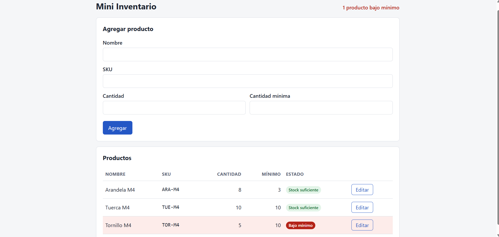

# Bitácora — Día 3: Primera versión web de Mini Inventario

- **Fecha:** 2026-11-13
- **Repositorio:** https://github.com/JessBlack-GT/mini-inventario
- **Rama:** `dia-03-web`
- **Asistente:** Claude Code

## 1. Objetivo y alcance

**Objetivo:** construir la primera versión funcional de Mini Inventario a partir de `docs/requisitos.md` y `docs/diseno.md`. Esta versión permite listar, agregar y editar productos, y marca los que están bajo mínimo.

**Alcance acordado para hoy (desviaciones del diseño, documentadas):**

- Los datos se guardan en el `localStorage` del navegador. Supabase se integrará después.
- Todo el acceso a datos está en `public/productos.js`, con funciones asíncronas. Así, al cambiar a Supabase solo habrá que reemplazar ese archivo.
- No hay inicio de sesión todavía.
- Quedan pendientes eliminar (HU5), el ajuste rápido +/− (HU4), la búsqueda y el filtro.

| Archivo | Contenido |
|---|---|
| `src/server.js` | Servidor Express: sirve `public/`, responde `GET /health` y usa `PORT` o 3000 |
| `public/index.html` | Página única: formulario, contador y tabla de productos |
| `public/app.js` | Interfaz; accede a los datos solo mediante `productos.js` |
| `public/productos.js` | Capa de datos y validaciones (localStorage) |
| `public/estilos.css` | Estilos |
| `test/server.test.js` | 2 pruebas con `node:test` |
| `package.json` | Scripts `start`, `dev` y `test` |
| `README.md` | Sección "Cómo ejecutar" |

## 2. Prompts clave

Los cinco prompts son copias literales y completas de los mensajes enviados.

1. **Primera versión:**
   > Lee docs/requisitos.md y docs/diseno.md. Construye la primera versión de Mini Inventario. Express sirve la carpeta public/, responde /health y usa process.env.PORT o el puerto 3000. La página lista, agrega y edita productos, y marca los que tienen una cantidad por debajo del mínimo. Todo el acceso a datos va en public/productos.js y por ahora usa localStorage, porque mañana lo cambiaremos por Supabase. No agregues inicio de sesión todavía. Explica tu plan antes de editar.

2. **Mejora visual de la columna Estado:**
   > Probé la web en el navegador. Funcionan el alta, la edición, la persistencia al recargar y la validación de nombre y SKU vacíos. En la tabla observé que la columna Estado queda vacía cuando la cantidad es igual o superior al mínimo. Corrige ese detalle para que muestre «Stock suficiente» en esos casos y conserve «Bajo mínimo» cuando la cantidad sea menor al mínimo. No cambies el contador ni el almacenamiento en public/productos.js. Antes de editar, muéstrame qué cambiarías. No hagas commit, push ni abras el PR todavía.

3. **Revisión acotada:**
   > Revisa solo public/productos.js y dime si algo no cumple docs/diseno.md

4. **Propuesta de corrección:**
   > Muéstrame primero el cambio mínimo en public/productos.js para que cantidad y minimo acepten enteros de 0 a 2147483647. Conserva las validaciones actuales. Después de mi aprobación, aplica el cambio y comprueba que ambos campos acepten 2147483647 y rechacen 2147483648 sin guardar el producto ni alterar el inventario. No agregues Supabase ni inicio de sesión. No hagas commit, push ni abras el PR todavía.

5. **Aprobación y verificación:**
   > Sí, aplica el cambio únicamente en public/productos.js y ejecuta las pruebas que propusiste. Confirma que ambos campos acepten 2147483647, rechacen 2147483648 y que cada intento rechazado deje el inventario intacto. Ejecuta también npm test y muéstrame los resultados. No hagas commit, push ni abras el PR todavía.

En todos los pasos el agente mostró su plan o el cambio antes de editar, y no hizo commit, push ni pull request.

## 3. Cómo se comprobó la primera versión

- **Pruebas automáticas:** `npm test` (2 de 2). Comprueba que `GET /health` responde 200 con `{status:'ok'}`, que se sirve la página principal y que `/productos.js` se entrega como JavaScript.
- **13 casos iniciales de reglas de datos:** al construir la primera versión, un script temporal con `localStorage` simulado verificó 13 casos de validación de `public/productos.js`. Todos pasaron. Estos casos son anteriores a la corrección del límite (sección 5).
- **Prueba manual en el navegador (realizada por mí):**
  1. Registré tres productos.
  2. Edité el tornillo (`TOR-M4`) de 5 a 10 y luego lo regresé a 5.
  3. Recargué la página y los datos se conservaron.
  4. El formulario rechazó un nombre vacío y un SKU vacío.

### Captura final



La captura muestra:

- el contador «1 producto bajo mínimo»;
- `ARA-M4` (8/3) y `TUE-M4` (10/10) con «Stock suficiente»;
- `TOR-M4` (5/10) con «Bajo mínimo» y la fila resaltada.

## 4. Mejora visual: columna Estado

- **Problema:** durante la prueba manual noté que la columna Estado quedaba vacía cuando la cantidad era igual o mayor que el mínimo.
- **Corrección:**
  - en `public/app.js`, la celda siempre muestra una etiqueta: «Bajo mínimo» (rojo) o «Stock suficiente» (verde);
  - en `public/estilos.css` se añadió el estilo verde.
- **Sin cambios:** el contador y `public/productos.js`.
- **Verificación:**
  - `node --check public/app.js` sin errores;
  - `npm test`: 2 de 2;
  - la captura final muestra ambas etiquetas.

## 5. Problema detectado: cantidades por encima del límite de Postgres

- **Detección:** al revisar solo `public/productos.js` frente a `docs/diseno.md`, el agente encontró que la primera versión aceptaba cantidades y mínimos de hasta `Number.MAX_SAFE_INTEGER` (unos 9 mil billones). En cambio, las columnas `integer` de Postgres (§3 del diseño) solo admiten hasta 2 147 483 647. Por ejemplo, `3000000000` se guardaba en localStorage, pero fallaría al migrar a Supabase.
- **En ese momento no se editó nada:** el agente solo informó el hallazgo, junto con dos diferencias menores (cómo se cuentan algunos caracteres y los nombres `creadoEn`/`created_at`), y propuso la corrección.
- **Corrección (en `entero()` de `public/productos.js`):**
  - se añadió la constante `MAXIMO_ENTERO = 2147483647`;
  - `Number.isSafeInteger(numero)` se reemplazó por `numero > MAXIMO_ENTERO`;
  - el nuevo mensaje de error es:
    - para la cantidad: «La cantidad no puede ser mayor que 2147483647»;
    - para el mínimo: «La cantidad mínima no puede ser mayor que 2147483647»;
  - se conservaron las validaciones anteriores (solo dígitos; se rechazan vacíos, negativos, decimales y notación científica).
- **Verificación:** ver la sección 6.

## 6. Resultados de la verificación de la corrección

Resumen de las pruebas del día:

| Prueba | Momento | Casos | Resultado |
|---|---|---|---|
| Reglas de datos (script temporal) | Primera versión | 13 | 13 OK |
| Límite 2147483647 (script temporal) | Tras la corrección | 10 | 10 OK |
| `npm test` (`node --test`) | Tras la corrección | 2 | 2 OK |

Además, `node --check public/productos.js` no mostró errores.

### 10 casos posteriores a la corrección del límite

En cada rechazo se comparó el contenido de `localStorage` antes y después, byte a byte.

| # | Caso | Resultado |
|---|---|---|
| 1 | Crear con cantidad 2147483647 | Se guarda |
| 2 | Crear con mínimo 2147483647 | Se guarda |
| 3 | Editar con ambos en 2147483647 | Se guarda |
| 4 | Crear con cantidad 2147483648 | Rechazado en Cantidad; inventario intacto |
| 5 | Crear con mínimo 2147483648 | Rechazado en Mínimo; inventario intacto |
| 6 | Editar con cantidad 2147483648 | Rechazado; inventario intacto |
| 7 | Editar con mínimo 2147483648 | Rechazado; inventario intacto |
| 8 | Crear con `99999999999999999999` | Rechazado; inventario intacto |
| 9 | Crear con `-1`, `2.5`, `1e3` o vacío | Rechazados con el mensaje anterior |
| 10 | Revisar el inventario tras los rechazos | Mismo total; `TOR-M4` sigue en 5/10 |

Resultado: `10 casos OK`. El script era temporal y no forma parte del repositorio.

### 2 pruebas de `npm test`

```
✔ GET /health responde 200 con status ok
✔ sirve la página principal y la capa de datos desde public/
ℹ tests 2  ·  pass 2  ·  fail 0
```

## 7. Uso del contexto

| Momento | `/context` |
|---|---|
| Antes de `/compact` | 79.7 mil tokens (8 %) |
| Después de `/compact` | 63.5 mil tokens (6 %) |

La primera respuesta resumía toda la aplicación. Después, la revisión acotada a un solo archivo (`public/productos.js`), comparado con un solo documento (`docs/diseno.md`), detectó un caso límite concreto: el tope de 2 147 483 647. En ese momento no se editó nada; el cambio se aplicó solo después de ver la propuesta y aprobarla.

## 8. Decisiones de aprobación

### Comando autorizado: `npm test`

- **Qué hace:** ejecuta las pruebas de `test/server.test.js` con `node --test`.
- **Por qué lo autoricé:** lo pedí en el mismo mensaje en que aprobé la corrección de `public/productos.js` (sección 2, prompt 5). Quería comprobar que el servidor seguía respondiendo en `/health` y sirviendo los archivos de `public/` después del cambio.
- **Resultado:** 2 pruebas, 2 aprobadas, 0 fallidas.
- La autorización consta en el mensaje del chat; esta bitácora no registra una ventana de aprobación aparte.

### Acciones pospuestas

- Commit, push y pull request: no autorizados todavía.

## 9. Estado actual

- **Rama:** `dia-03-web`, sin commits nuevos. `README.md` está modificado, y `package.json`, `package-lock.json`, `public/`, `src/`, `test/` y `entregas/dia-03/` no tienen seguimiento todavía.
- **Pendiente:** commit, push y pull request, cuando se autoricen.
- **Fuera del alcance de hoy:** Supabase, inicio de sesión, eliminar, ajuste +/−, búsqueda y filtro.
