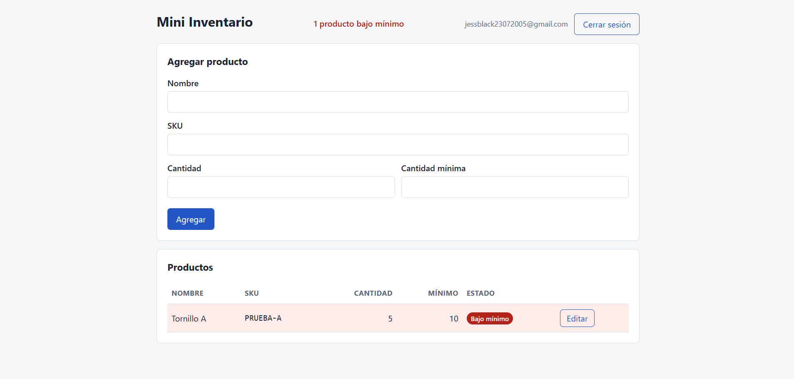
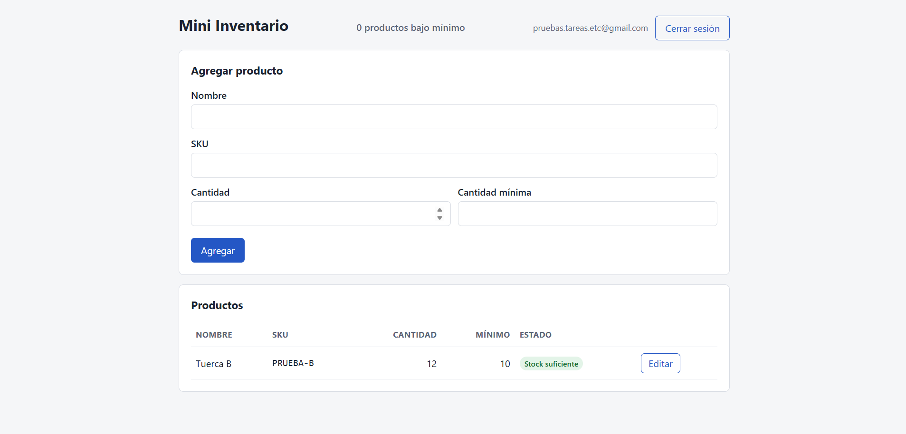
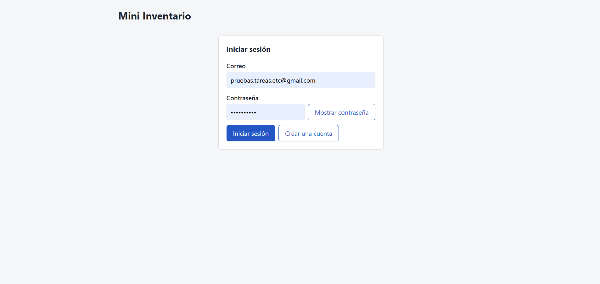

# Bitácora — Día 4: Supabase, RLS e inicio de sesión

- **Fecha:** 2026-11-17
- **Repositorio:** https://github.com/JessBlack-GT/mini-inventario
- **Rama:** `dia-04-supabase`
- **Asistente:** Claude Code (con el MCP de Supabase y las skills `supabase` y `supabase-postgres-best-practices`)

## 1. Objetivo y alcance

**Objetivo:** crear en Supabase la tabla `productos`, protegida con Row Level Security, y conectar la web a Supabase con registro e inicio de sesión. Los datos dejan de guardarse en `localStorage`.

**Alcance acordado para hoy (desviaciones del diseño, documentadas):**

- `public/productos.js` consulta Supabase directamente desde el navegador. `docs/diseno.md` preveía que los productos pasaran por una API de Express. La seguridad descansa en RLS y en los permisos de la tabla, que se verificaron (sección 3).
- Las variables se llaman `SUPABASE_URL` y `SUPABASE_KEY`, como pedía el prompt; el diseño usaba `SUPABASE_ANON_KEY`.
- Una sola página (`index.html`) muestra el acceso o el inventario según la sesión. El diseño preveía `index.html` e `inventario.html` por separado.
- Quedan pendientes la función `ajustar_cantidad`, eliminar (HU5), el ajuste rápido +/− (HU4), la búsqueda y el filtro.

| Archivo | Contenido |
|---|---|
| `supabase/esquema.sql` | SQL aplicado: tabla, índice, RLS, 4 políticas y permisos |
| `src/server.js` | Lee `.env`; sirve `/config.js` (solo llave publishable o anon) y `/vendor/supabase.js` |
| `public/supabase.js` | Cliente de Supabase del navegador |
| `public/auth.js` | Registro, inicio y cierre de sesión con correo y contraseña |
| `public/productos.js` | Capa de datos sobre la tabla `productos` (antes, `localStorage`) |
| `public/app.js` | Pantalla de acceso, botón Mostrar contraseña, cierre de sesión e inventario |
| `public/index.html`, `public/estilos.css` | Formulario de acceso y estilos |
| `test/server.test.js` | 8 pruebas con `node:test` |
| `.env.example` | Nombres de las variables, sin valores |
| `package.json`, `package-lock.json` | `@supabase/supabase-js` con versión fija 2.119.0 |

## 2. Prompts clave

Los dos prompts del profesor son copias literales y completas de los mensajes enviados.

1. **Migración con RLS:**
   > Usa el MCP de Supabase solo en este proyecto y sigue las skills supabase y supabase-postgres-best-practices. Crea una migración con la tabla productos según docs/diseno.md. Activa Row Level Security y crea políticas para que cada usuario solo pueda leer, crear, editar y borrar sus propios productos. Muéstrame el SQL antes de aplicarlo.

2. **Conectar la web a Supabase:**
   > Cambia public/productos.js para usar Supabase en lugar de localStorage. Agrega registro e inicio de sesión con correo y contraseña. Lee SUPABASE_URL y SUPABASE_KEY del archivo .env y entrégalas al navegador desde la ruta /config.js. Usa solo la llave publishable o anon, nunca la service_role. Crea un .env.example sin valores.

Entre esos dos prompts y después de ellos, también pedí:

- ajustar los permisos del SQL y mostrarlo completo;
- confirmar la línea `REVOKE`;
- dividir dos sentencias en líneas cortas;
- agregar el botón Mostrar contraseña y corregir el cambio de modo (sección 5).

El agente mostró el SQL o el cambio antes de aplicarlo, y no hizo commit, push ni pull request.

## 3. Migración `crear_tabla_productos`

### Qué SQL aprobé y por qué

- **Tabla `productos`:** sigue `docs/diseno.md` §3: `user_id` con `default auth.uid()` y borrado en cascada, `check` en nombre, SKU, cantidad y mínimo, e índice único `(user_id, lower(sku))`.
- **RLS activo y 4 políticas** (`ver propios`, `crear propios`, `editar propios`, `eliminar propios`). Respecto al diseño, aplican las buenas prácticas de las skills:
  - `(select auth.uid())` en lugar de `auth.uid()`: se calcula una vez por consulta, no una vez por fila;
  - `to authenticated` en cada política: el rol `anon` no llega a evaluarlas;
  - la política de `update` tiene `using` y `with check`, así que nadie puede cambiar `user_id` para pasarle un producto a otra cuenta.
- El índice único empieza por `user_id`, así que también sirve para las políticas; no hizo falta otro índice.

### Ajuste técnico del `REVOKE` (cambia los permisos)

- **Propuesta inicial del agente:** `revoke all … from public, anon;`, situado antes de activar RLS.
- **Lo que pedí:** dejar el bloque de permisos al final, después de RLS y las políticas, y añadir `authenticated` al `REVOKE`:
  ```sql
  REVOKE ALL ON TABLE public.productos FROM PUBLIC, anon, authenticated;
  GRANT SELECT, INSERT, UPDATE, DELETE ON TABLE public.productos TO authenticated;
  ```
- **Por qué:** así `authenticated` no conserva permisos de más que Supabase concede por defecto (`TRUNCATE`, `REFERENCES`, `TRIGGER`). Primero se quitan todos y después se devuelven solo los cuatro necesarios.
- Como la terminal cortaba la línea en «authen», pedí verla sola y confirmé que terminaba en `authenticated;`.

### Cambio de formato (no cambia el SQL)

- **Qué pasó:** la ventana de aprobación de *Apply migration* recortaba dos líneas largas.
- **Qué pedí:** que la solicitud se mostrara con líneas más cortas antes de aprobarla, con estas sentencias divididas:
  ```sql
  ALTER TABLE public.productos
    ENABLE ROW LEVEL SECURITY;

  REVOKE ALL ON TABLE public.productos
    FROM PUBLIC, anon, authenticated;
  ```
- **Efecto:** solo cambian los saltos de línea; el resultado es el mismo. A diferencia del ajuste del `REVOKE`, este cambio no modifica ningún permiso: solo sirvió para leer la solicitud completa antes de aprobarla.

### Verificación (consultas de solo lectura)

| Comprobación | Resultado |
|---|---|
| Migración registrada | `20261117205756 crear_tabla_productos` |
| `public.productos` existe con RLS activo | `rls_activo = true` |
| Políticas | 4, todas `to authenticated` con `(SELECT auth.uid()) = user_id` |
| `anon` | Sin ningún permiso sobre la tabla |
| `authenticated` | `SELECT`, `INSERT`, `UPDATE` y `DELETE`; sin `TRUNCATE`, `REFERENCES` ni `TRIGGER` |
| Avisos de seguridad y rendimiento (`get_advisors`) | Ninguno |

El SQL aplicado se guardó en `supabase/esquema.sql`.

## 4. Conexión de la web a Supabase

- **`/config.js`:** entrega `SUPABASE_URL` y `SUPABASE_KEY` como módulo, sin caché.
  - Solo acepta una llave `sb_publishable_…` o la `anon` antigua.
  - Si la llave es `service_role`, `sb_secret_…` o cualquier otra cosa, responde 500 y no la incluye en la respuesta.
- **`.env`:** el servidor lo lee al arrancar. `git check-ignore -v .env` → `.gitignore:2:.env`: el archivo real está ignorado y sus valores no se mostraron.
- **`.env.example`:** contiene `SUPABASE_URL=`, `SUPABASE_KEY=` y `PORT=`, sin valores.
- **`productos.js`:** el navegador nunca envía `user_id`; lo pone la base de datos. Los errores de Postgres se traducen a mensajes para el formulario (por ejemplo, `23505` → «El SKU ya existe»).
- **Registro:** está implementado en `public/auth.js`. Al registrarse sale siempre el mismo mensaje, exista o no el correo. **La confirmación por correo no se probó** (ver la prueba con dos cuentas).
- **Inicio de sesión** (mensajes de `docs/diseno.md` §5):
  - si falta confirmar el correo, sale «Confirma tu correo antes de iniciar sesión»;
  - con cualquier otro fallo, sale «Correo o contraseña incorrectos»;
  - la sesión se comprueba con `getUser()` antes de mostrar el inventario.

### 8 pruebas de `npm test`

```
✔ GET /health responde 200 con status ok
✔ sirve la página principal y la capa de datos desde public/
✔ sirve el cliente de Supabase para el navegador
✔ GET /config.js entrega la URL y una llave publishable
✔ GET /config.js acepta la llave anon heredada
✔ GET /config.js nunca entrega una llave service_role ni secret
✔ GET /config.js responde 500 si falta la configuración
✔ esLlavePublica distingue llaves públicas de privadas
ℹ tests 8  ·  pass 8  ·  fail 0
```

### Prueba con dos cuentas (realizada por mí)

Para la prueba manual usamos dos cuentas ya confirmadas (A y B). El registro está implementado, pero **la confirmación por correo no se probó**.

| Cuenta | Producto | SKU | Cantidad | Mínimo | Estado |
|---|---|---|---|---|---|
| A | Tornillo A | `PRUEBA-A` | 5 | 10 | Bajo mínimo |
| B | Tuerca B | `PRUEBA-B` | 12 | 10 | Stock suficiente |

1. Con la cuenta A creé `PRUEBA-A`.
2. Con la cuenta B creé `PRUEBA-B`.
3. A solo vio `PRUEBA-A` y B solo vio `PRUEBA-B`.
4. Una consulta de solo lectura en Supabase confirmó que hay una fila de cada SKU y que pertenecen a **2 propietarios distintos**.

#### Cuenta A



Muestra solo `PRUEBA-A` (5/10) con «Bajo mínimo» y el contador «1 producto bajo mínimo».

#### Cuenta B



Muestra solo `PRUEBA-B` (12/10) con «Stock suficiente» y el contador «0 productos bajo mínimo».

#### Evidencia adicional: pantalla de inicio de sesión



Muestra el formulario «Iniciar sesión» con la contraseña oculta y los botones «Mostrar contraseña» y «Crear una cuenta».

## 5. Botón Mostrar contraseña y problema detectado al cambiar de modo

- **Mejora:** se agregó un botón `type="button"` junto al campo Contraseña.
  - La contraseña está oculta por defecto.
  - Al pulsarlo, se muestra sin borrar lo escrito y el texto cambia a «Ocultar contraseña»; al pulsarlo otra vez, se oculta.
  - Funciona con el teclado: Tab para llegar, Enter o Espacio para activarlo.
  - No envía el formulario.
- **Problema que detecté:** al pasar de «Iniciar sesión» a «Crear una cuenta», o al revés con «Ya tengo cuenta», se conservaban el correo y la contraseña del modo anterior.
- **Corrección (solo en `cambiarModo()` de `public/app.js`).** Al cambiar de modo:
  - se vacían Correo y Contraseña;
  - se borran los avisos y errores;
  - se llama a `verContrasena(false)` para ocultar otra vez la contraseña;
  - el foco pasa a Correo;
  - se conserva el autocomplete de cada modo: `current-password` al iniciar sesión y `new-password` al crear cuenta.
- **Sin cambios:** pulsar Mostrar u Ocultar contraseña sigue sin borrar lo escrito. No se tocaron Supabase, `auth.js` ni las validaciones.
- **Verificación:**
  - `node --check public/app.js` sin errores;
  - `npm test`: 8 de 8;
  - comprobación manual en ambos sentidos (Iniciar sesión → Crear una cuenta, y Crear una cuenta → Ya tengo cuenta): los campos quedaron vacíos, la contraseña oculta y el foco en Correo.

## 6. Decisiones de aprobación

### Migración autorizada: `apply_migration` → `crear_tabla_productos`

- **Qué hace:** crea la tabla `productos`, el índice, RLS, las 4 políticas y los permisos en el proyecto de Supabase del curso.
- **Por qué la autoricé:**
  - revisé el SQL completo;
  - pedí el ajuste técnico del `REVOKE` y confirmé la línea exacta;
  - limité la autorización a esa única migración, sin `ajustar_cantidad` ni otros cambios en Supabase.
- **Formato de la solicitud:** pedí que la solicitud se mostrara con líneas más cortas antes de aprobarla. Fue solo un cambio de formato, distinto del ajuste técnico del `REVOKE` (sección 3).
- **Resultado:** migración `20261117205756` aplicada y verificada con consultas de solo lectura.

### Acciones pospuestas

- Commit, push y pull request: no autorizados todavía.

## 7. Estado actual

- **Rama:** `dia-04-supabase`, sin commits nuevos.
  - Modificados: `package.json`, `package-lock.json`, `public/` y `src/server.js`, `test/server.test.js`.
  - Sin seguimiento todavía: `public/auth.js`, `public/supabase.js`, `supabase/`, `.env.example` y `entregas/dia-04/`.
- **`.env`:** existe localmente y está ignorado por git.
- **Pendiente:** commit, push y pull request, cuando se autoricen.
- **Fuera del alcance de hoy:** `ajustar_cantidad`, eliminar, ajuste +/−, búsqueda, filtro y la prueba de la confirmación por correo.
