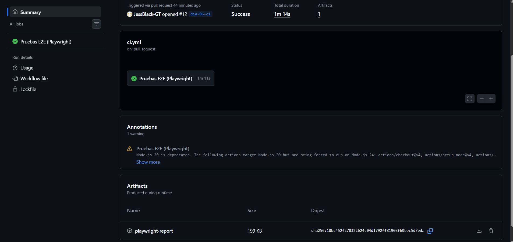
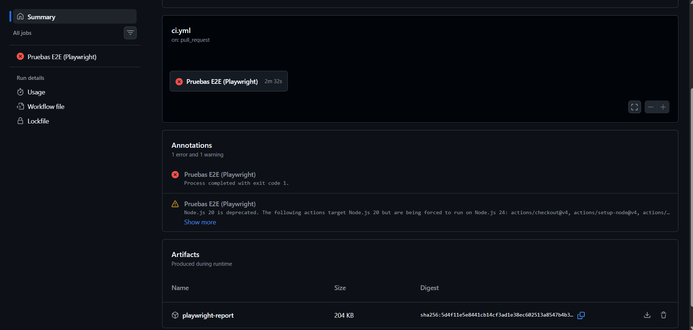
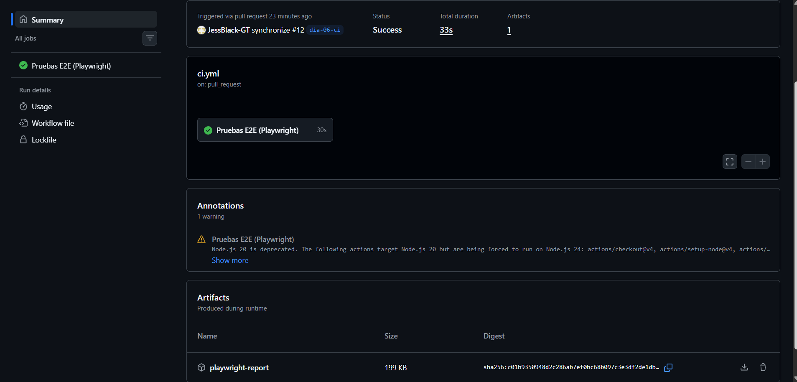

# Bitácora — Día 6: CI con GitHub Actions y diagnóstico de una falla

- **Fecha:** 2026-11-20
- **Repositorio:** https://github.com/JessBlack-GT/mini-inventario
- **Rama:** `dia-06-ci`
- **Pull request:** [#12 — Configura CI de Playwright para el Día 6](https://github.com/JessBlack-GT/mini-inventario/pull/12)
- **Asistente:** Claude Code, con `gh`

## 1. Objetivo y alcance

**Objetivo:** ejecutar las pruebas de Playwright en cada pull request hacia `main`, provocar una falla controlada, diagnosticarla con `gh` a partir de los logs y corregirla.

| Archivo | Contenido |
|---|---|
| `.github/workflows/ci.yml` | Job `Pruebas E2E (Playwright)` en `ubuntu-latest` con Node 22: `npm ci`, Chromium con sus dependencias, pruebas con los reporters `list` y `html`, verificación del reporte y subida del artefacto |
| `scripts/verificar-reporte.js` | Revisa que `playwright-report/` no contenga ninguno de los cuatro secretos antes de publicarlo |
| `tests/inventario.spec.js` | `iniciarSesion` rellena los campos con `locator.evaluate` en lugar de `fill`, para que las credenciales no queden en los títulos de los pasos del reporte |
| `.gitignore` | Ignora `/playwright-report/` |

**Manejo de secretos:** `SUPABASE_URL`, `SUPABASE_KEY`, `TEST_EMAIL` y `TEST_PASSWORD` se guardan como secretos del repositorio. Solo los reciben el paso de pruebas y el de verificación. GitHub los enmascara en el log como `***`. Esta bitácora no incluye ningún valor.

## 2. Prompts de la práctica

Copias literales de los mensajes enviados.

1. **Creación del workflow:**
   > Crea .github/workflows/ci.yml para que en cada pull request hacia main se ejecute en ubuntu-latest con Node 22: npm ci, instalación de Chromium con sus dependencias y las pruebas de Playwright. Pasa como variables de entorno los secretos SUPABASE_URL, SUPABASE_KEY, TEST_EMAIL y TEST_PASSWORD. Sube el reporte de Playwright como artefacto. Después abre un pull request con gh.

2. **Diagnóstico:**
   > https://github.com/JessBlack-GT/mini-inventario/pull/12
   >
   > Las verificaciones de este pull request fallaron. Usa gh pr checks, gh run list y gh run view con --log-failed para encontrar la causa. Explícamela antes de corregir. Cuando la apruebe, corrige, sube el cambio y comprueba que todo pase.

3. **Aprobación de la corrección:**
   > Apruebo la corrección. Restaura únicamente la aserción de tests/inventario.spec.js para que espere «Correo o contraseña incorrectos». Revisa que el diff solo cambie esa línea, haz commit y push a dia-06-ci, y espera la nueva ejecución del PR #12.
   >
   > Confirma que Actions termine en verde con 7 pruebas aprobadas, ninguna fallida ni omitida, y que se publique el artefacto playwright-report tras pasar la verificación. Dame el enlace de la ejecución. No hagas merge todavía.

## 3. Ejecuciones del PR #12

| # | Ejecución | Commit | Resultado | Pruebas | Verificación del reporte | Artefacto |
|---|---|---|---|---|---|---|
| 1 | [44683277410](https://github.com/JessBlack-GT/mini-inventario/actions/runs/44683277410) | `ba4be34` Configura CI de Playwright | ✅ success | 7 pasaron (12.6 s) | Pasó: 4 contenidos revisados, sin secretos | `playwright-report`, 203 347 bytes |
| 2 | [44684810428](https://github.com/JessBlack-GT/mini-inventario/actions/runs/44684810428) | `baafef8` Prueba controlada de CI | ❌ failure | 6 pasaron, 1 falló (también en el reintento) | Pasó: 5 contenidos revisados, sin secretos | `playwright-report`, 208 594 bytes |
| 3 | [44685772427](https://github.com/JessBlack-GT/mini-inventario/actions/runs/44685772427) | `34b0a1a` Restaura la aserción | ✅ success | 7 pasaron (9.9 s), sin reintentos | Pasó: 4 contenidos revisados, sin secretos | `playwright-report`, 203 434 bytes |

En ninguna ejecución hubo pruebas omitidas ni inestables (flaky). En la ejecución 2 el reporte también se verificó y se subió, porque esos pasos corren con `!cancelled()` aunque fallen las pruebas.

### Capturas

Las capturas muestran el resumen de cada ejecución en GitHub Actions. No muestran el número de la ejecución, así que cada una se identificó por el digest del artefacto `playwright-report` visible en la imagen, comparado con el que devuelve la API de GitHub para esa ejecución.

| Captura | Ejecución | Qué muestra | Digest del artefacto |
|---|---|---|---|
| [01-verde-inicial.png](./01-verde-inicial.png) | 1 — [44683277410](https://github.com/JessBlack-GT/mini-inventario/actions/runs/44683277410) | Success, duración total 1m 14s, abierta con «opened #12», artefacto de 199 KB | `sha256:18bc452f…` |
| [02-rojo-intencional.png](./02-rojo-intencional.png) | 2 — [44684810428](https://github.com/JessBlack-GT/mini-inventario/actions/runs/44684810428) | Job fallido (2m 32s), anotación «Process completed with exit code 1.», artefacto de 204 KB | `sha256:5d4f11e5…` |
| [03-verde-final.png](./03-verde-final.png) | 3 — [44685772427](https://github.com/JessBlack-GT/mini-inventario/actions/runs/44685772427) | Success, duración total 33s, «synchronize #12», artefacto de 199 KB | `sha256:c01b9350…` |







Las tres capturas muestran también el aviso de GitHub sobre la obsolescencia de Node.js 20 en `actions/checkout@v4`, `actions/setup-node@v4` y `actions/upload-artifact@v4`. Es solo una advertencia y no hizo fallar ninguna ejecución.

Después, el commit de esta bitácora (`16051a3`) disparó la ejecución [44688076373](https://github.com/JessBlack-GT/mini-inventario/actions/runs/44688076373): 7 pasaron, reporte verificado y artefacto publicado. Esa ejecución no reemplaza a ninguna de las tres anteriores y no tiene captura.

## 4. Diagnóstico de la falla intencional

**Comandos:** `gh pr checks 12`, `gh run list --branch dia-06-ci` y `gh run view 44684810428 --log-failed`.

**Check que falló:** `Pruebas E2E (Playwright)`, en el paso «Ejecutar pruebas de Playwright».

**Prueba:** `tests/inventario.spec.js:89` › *rechaza una contraseña incorrecta*.

```
Error: expect(locator).toHaveText(expected) failed

Locator:  locator('#error-acceso')
Expected: "Falla intencional del Día 6"
Received: "Correo o contraseña incorrectos"
```

**Causa:** la app funcionaba bien. El call log muestra que `#error-acceso` empezó vacío y luego mostró «Correo o contraseña incorrectos», que es el mensaje correcto ante una contraseña incorrecta. El error estaba en la prueba. El commit `baafef8` cambió solo la línea 92 para esperar un texto que la app nunca muestra:

```diff
-  await expect(page.locator('#error-acceso')).toHaveText('Correo o contraseña incorrectos');
+  await expect(page.locator('#error-acceso')).toHaveText('Falla intencional del Día 6');
```

**Causas descartadas:**

- **Secretos faltantes:** la comprobación previa no detuvo el paso, así que las cuatro variables tenían valor. Además, el inicio de sesión con la cuenta de prueba pasó.
- **Aviso `[WebServer] No se encontró .env`:** es esperado en CI, donde las variables vienen del entorno del paso y no de `.env`.
- **Otras pruebas:** las otras 6 pasaron, entre ellas agregar un producto y marcar un producto bajo el mínimo, que usan Supabase.

## 5. Corrección

Se restauró solo la aserción:

```diff
-  await expect(page.locator('#error-acceso')).toHaveText('Falla intencional del Día 6');
+  await expect(page.locator('#error-acceso')).toHaveText('Correo o contraseña incorrectos');
```

Comprobaciones antes del commit:

- La rama activa era `dia-06-ci`.
- `git diff ba4be34 -- tests/inventario.spec.js` no mostró diferencias: el archivo quedó igual que antes de la prueba.
- `tests/inventario.spec.js` era el único archivo preparado. `.claude/`, `.mcp.json` y `skills-lock.json` quedaron fuera.
- `git add`, `git commit` y `git push origin dia-06-ci` se encadenaron con comprobaciones de `$LASTEXITCODE` y `&&`, para que no hubiera push si fallaba un paso anterior.

Resultado: la ejecución 3 terminó en verde con 7 pruebas aprobadas y `gh pr checks 12` mostró `pass`.

## 6. Cómo se verificó el reporte antes de publicarlo

El repositorio es público, así que cualquiera podría descargar el artefacto. El paso «Verificar que el reporte no contenga secretos» ejecuta `node scripts/verificar-reporte.js playwright-report`, y «Subir reporte de Playwright» solo corre si ese paso terminó bien (`steps.verificar.outcome == 'success'`).

El verificador:

1. Exige que los cuatro secretos estén en el entorno. Si falta alguno, falla, porque la búsqueda no tendría sentido.
2. Revisa todos los archivos de `playwright-report/`. Además, descomprime el zip en base64 que Playwright incrusta en `index.html`, donde va el JSON con los pasos de cada prueba.
3. Busca cada secreto tal cual, escapado como cadena JSON y codificado para URL.
4. Falla de forma cerrada: si encuentra un secreto, si falta `index.html` o si no puede leer el zip, termina con código 1. Nunca imprime los valores, solo el nombre del secreto y el archivo.

En las tres ejecuciones el log mostró `Reporte verificado: … contenidos revisados, sin secretos.` antes de subir el artefacto.

## 7. Incidente en la validación local: `env -i` quitó el `PATH`

**Qué pasó:** al validar localmente la comprobación de secretos faltantes del workflow con valores ficticios, se usó `env -i` para partir de un entorno vacío. `env -i` limpió todo el entorno, incluido `PATH`. El primer intento no encontró `bash` y terminó con **código 127** (comando no encontrado), sin llegar a ejecutar la comprobación.

**Corrección:** se repitió la prueba resolviendo la ruta absoluta de `bash` antes de limpiar el entorno, así que el intérprete ya no dependía de `PATH`.

**Resultado:**

| Caso | Salida | Código |
|---|---|---|
| Faltan dos variables | Mostró solo los nombres de las faltantes, sin valores | 1 |
| Las cuatro variables definidas (valores ficticios) | Continuó sin error | 0 |

**Alcance:** fue una prueba local. No tuvo relación con la falla de la ejecución 2 en GitHub Actions, que se debió solo a la aserción cambiada a propósito.

## 8. Pendientes

- Hacer merge del PR #12 después de la revisión.
- GitHub no pasa secretos a los PR que vienen de forks. En ese caso el job falla en la comprobación de secretos y no se sube ningún artefacto.
